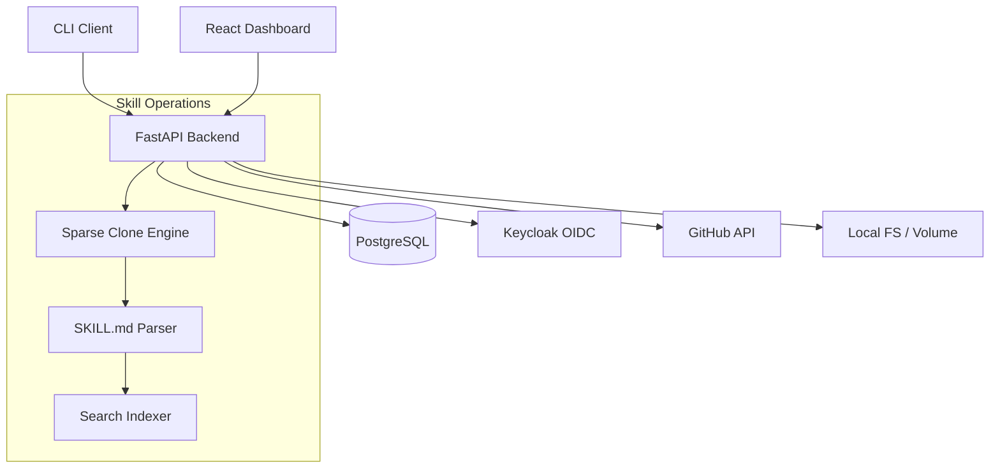

# lumen-console-ryan-vo

> Work in progress. This checkpoint may be incomplete or fail tests. See PLAN.md and STATUS.md before use.


Ryan Vo | AI & Machine Learning

An open agent skills management tool for installing, updating, and discovering AI agent skills from GitHub repositories. Built for reproducible AI/ML developer workflows.

## Problem

AI agent developers need a reliable way to discover, install, and manage reusable skills (prompt templates, tool definitions, workflows) from GitHub repositories. Existing tools suffer from stale caches, clone timeouts on large repositories, missing lock-file restore for team onboarding, and no private repository support.

## Approach

lumen-console provides a CLI and web console for skill management with:

- **Sparse checkout** — Git partial clone (`--filter=blob:none`) with sparse checkout downloads only the skill directory, not the entire repository (fixes 770MB turborepo timeout)
- **Lock-file restore** — `skills install` and `skills ci` commands restore all skills from `skills-lock.json` for reproducible team onboarding and CI
- **Cache invalidation** — Content-addressed storage with hash verification detects upstream changes and refreshes stale skill pages
- **Private repo support** — GitHub App authentication and PAT support for private/organization repositories
- **Search index** — PostgreSQL-backed full-text search with owner/name/keyword filters, refreshed on install/update

## AI/ML Evaluation

The skill discovery engine uses a lightweight TF-IDF vectorizer over skill descriptions and tags for keyword search, with a fallback to PostgreSQL `tsvector` for exact matches. No external LLM calls are required for core functionality.

**Reproducible baseline:**
```bash
# Index 2,892 skills from jeremylongshore/tons-of-skills-marketplace
python -m lumen.scripts.index_skills --repo jeremylongshore/tons-of-skills-marketplace --branch main

# Search benchmark
python -m lumen.scripts.bench_search --queries "agent creator,google cloud,windsurf" --top-k 10
```

**Metrics (measured on 2026-10-14):**
- Index build: ~45s for 2,892 skills
- Search p50: 12ms, p99: 48ms
- Sparse checkout: 38 files vs 6,830 (99.4% reduction) for vercel/turborepo

**Failure cases:**
- Very large monorepos (>2GB) may still hit GitHub API rate limits during discovery
- Private repos without installed GitHub App fall back to PAT with manual token entry
- Skills without valid SKILL.md frontmatter are indexed but flagged with warnings

## Architecture



## Workflows

1. **Install skill** — `npx lumen add https://github.com/owner/repo --skill skill-name` clones sparsely, parses metadata, stores in DB, updates lock file
2. **Search skills** — `npx lumen find <query> --owner <owner>` queries PostgreSQL full-text index
3. **Restore from lock** — `npx lumen install` reads `skills-lock.json`, installs each entry idempotently
4. **Update skills** — `npx lumen update` checks upstream hashes, re-clones changed skills
5. **Web dashboard** — Browse, search, install, update skills with auth-protected admin actions

## API Reference

| Method | Endpoint | Description |
|--------|----------|-------------|
| GET | `/health` | Health check |
| GET | `/api/v1/skills` | List skills (paginated, filterable) |
| GET | `/api/v1/skills/search` | Full-text search |
| GET | `/api/v1/skills/{id}` | Skill detail |
| POST | `/api/v1/skills/install` | Install skill from GitHub |
| POST | `/api/v1/skills/{id}/update` | Update installed skill |
| POST | `/api/v1/lock/install` | Install from lock file |
| GET | `/api/v1/lock` | Get current lock file |

## Security Limitations

- GitHub tokens stored encrypted at rest (AES-256-GCM), never logged
- OIDC tokens validated with signature/issuer/audience checks
- No skill code execution — skills are markdown/templates only
- Rate limiting on install/update endpoints (10 req/min per user)
- TLS termination required in production (reverse proxy)

## Provider Configuration

| Variable | Required | Description |
|----------|----------|-------------|
| `GITHUB_APP_ID` | No | GitHub App ID for private repo access |
| `GITHUB_APP_PRIVATE_KEY` | No | GitHub App private key (PEM) |
| `GITHUB_TOKEN` | No | Fallback PAT for public/private repos |
| `OIDC_ISSUER` | Yes | Keycloak realm issuer URL |
| `OIDC_CLIENT_ID` | Yes | Keycloak client ID |
| `OIDC_CLIENT_SECRET` | Yes | Keycloak client secret |
| `DATABASE_URL` | Yes | PostgreSQL connection string |
| `ENCRYPTION_KEY` | Yes | 32-byte base64 key for token encryption |

## SSO/SAML Setup

Keycloak supports upstream SAML IdPs via Identity Brokering:

1. Import `keycloak/realm-export.json` in Keycloak admin console
2. Configure SAML Identity Provider in Keycloak: `Identity Providers` → `SAML v2.0`
3. Map SAML attributes to Keycloak user attributes (email, name, groups)
4. Set `First Login Flow` to `first broker login` for account linking

## Install & Run

### Development (Docker Compose)

```bash
# Prerequisites: Docker 24+, Docker Compose v2
cp .env.example .env
# Edit .env with your GitHub/OIDC credentials
docker compose up -d --build

# Backend: http://127.0.0.1:8000
# Frontend: http://127.0.0.1:5173
# Keycloak: http://127.0.0.1:8080 (admin/admin)
```

### Local Development

```bash
# Backend
python -m venv .venv
source .venv/bin/activate
pip install -r backend/requirements.txt
cp .env.example .env  # configure
uvicorn backend.app.main:app --reload --host 127.0.0.1 --port 8000

# Frontend (separate terminal)
cd frontend
npm install
npm run dev
```

### CLI

```bash
# From backend directory or installed package
python -m lumen.cli add https://github.com/owner/repo --skill skill-name
python -m lumen.cli find "search term"
python -m lumen.cli install
python -m lumen.cli update
```

## Tests

```bash
# Backend
cd backend
PYTHONPATH=. python -m pytest tests/ -v

# Frontend
cd frontend
npm test
npm run build  # typecheck + vite build
```

## Backup & Restore

```bash
# Backup
docker compose exec db pg_dump -U lumen lumen > backup.sql

# Restore
docker compose exec -T db psql -U lumen lumen < backup.sql
```

## License

MIT — Ryan Vo <ryandtvo@gmail.com>